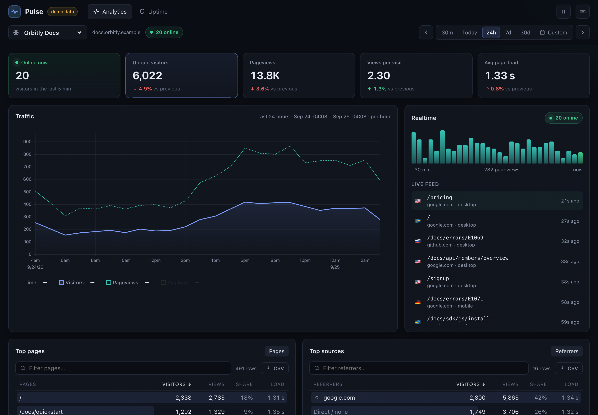
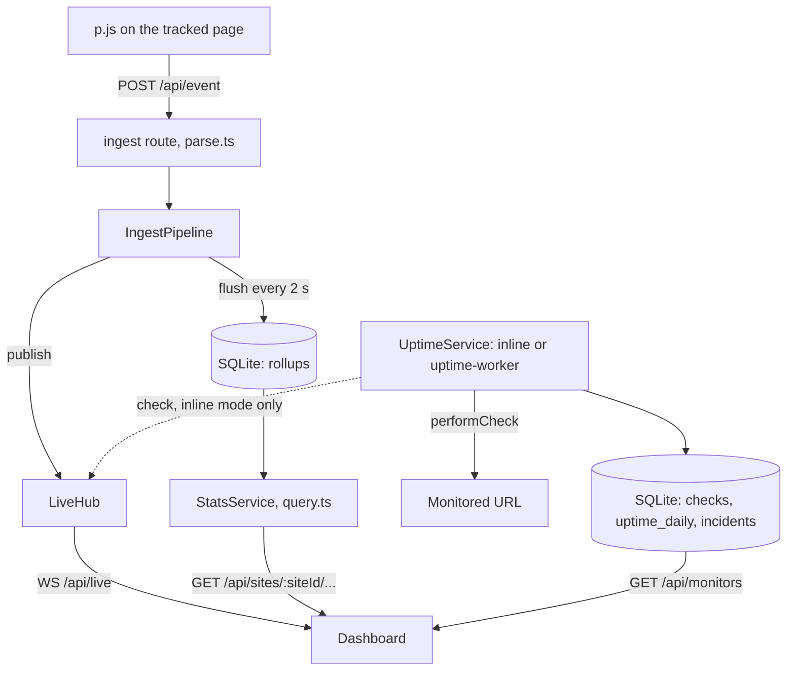
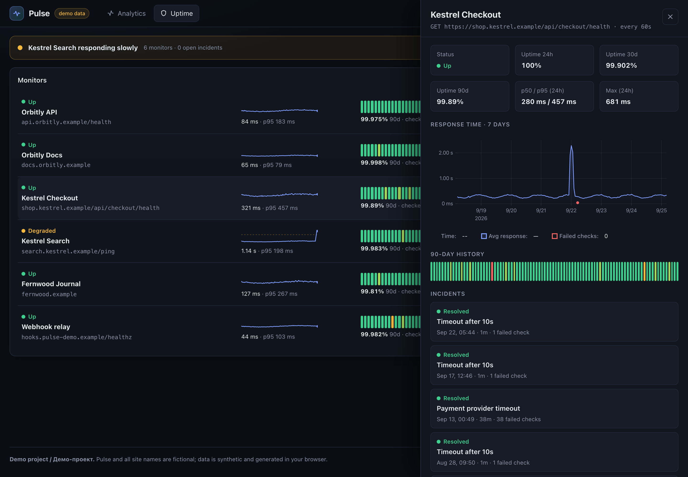
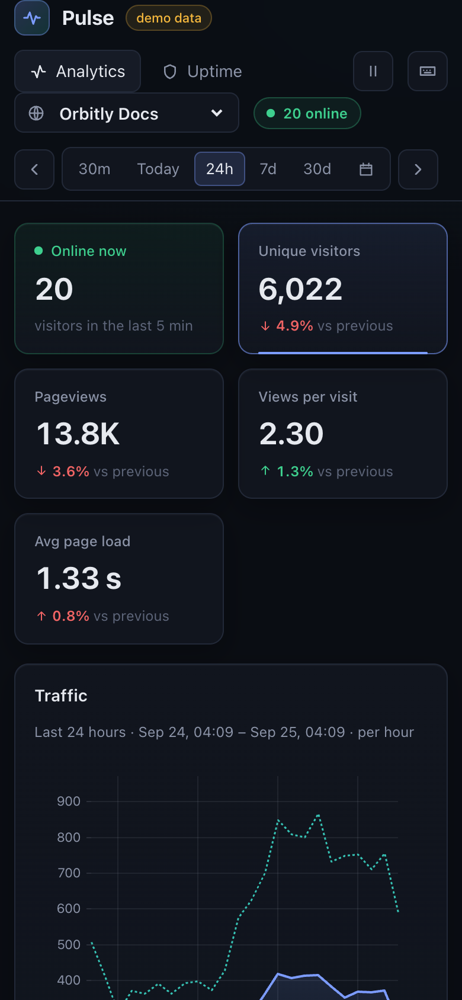

# Pulse

Cookieless web analytics and HTTP uptime monitoring in one dashboard. An 843-byte tracker sends pageviews to a Fastify API. The server folds them into per-minute, hourly and daily rollups in SQLite, keeps a HyperLogLog visitor sketch in every rollup row, and streams a live feed over WebSocket. The same TypeScript engine (`packages/core`) also runs in a Web Worker, which is how the demo works without a backend.

Demo (static build on GitHub Pages): https://sinnercode228.github.io/pulse-analytics/ · [Русская версия](#русская-версия)

None of the data is real. Orbitly, Kestrel and Fernwood are invented sites, the six demo monitors point at `.example` hosts, and every pageview and uptime check comes from the generators in [`packages/core/src/synth/`](packages/core/src/synth/). I built Pulse as a portfolio project to show how I work. It is not a client product and not a hosted service.



[](https://github.com/sinnercode228/pulse-analytics/actions/workflows/ci.yml)

## From p.js to the live feed

A pageview leaves `IngestPipeline` two ways: right away to the site's WebSocket subscribers through `LiveHub`, and into the rollup buffer that is written to SQLite every 2 s. Uptime checks run on their own timers in `UptimeService`, inside the API process by default or in `uptime-worker` on the same database file; only the in-process service pushes checks to the live feed. The text version with file paths is under [How it fits together](#how-it-fits-together).



Write-up on how unique visitors are counted without cookies: [How Pulse counts unique visitors with a daily salt and a sparse-to-dense HyperLogLog](https://github.com/sinnercode228/sinnercode228/blob/main/notes/pulse-hyperloglog.md).

## Numbers

I measured everything in this section on this checkout on 2026-10-02 (Node 25.8.2, esbuild 0.28.2), except the figures that name a later date. Each figure names the code it comes from, and each measured one comes with the command that reproduces it.

### Tracker: 843 B minified, 560 B gzipped

|                                               | bytes |
| --------------------------------------------- | ----- |
| minified (esbuild, `iife`, target `es2019`)   | 843   |
| gzip                                          | 560   |
| brotli                                        | 458   |
| budget                                        | 2,048 |

[`server/tracker/bundle.ts`](server/tracker/bundle.ts) bundles [`tracker.ts`](server/tracker/tracker.ts) in memory and reports `Buffer.byteLength` of the output and the length of its `gzipSync`. The budget is enforced twice: [`build-tracker.mjs:6-9`](server/scripts/build-tracker.mjs#L6-L9) exits non-zero above 2,048 bytes, and [`tracker.test.ts:47-50`](server/test/tracker.test.ts#L47-L50) asserts the same plus gzip under 1,024 bytes.

```bash
npm run build:tracker -w @pulse/server   # prints "tracker: 843 B minified, 560 B gzipped", writes server/public/p.js

# brotli is not part of the build; this prints all three sizes and writes nothing
cd server && node --input-type=module -e "import { bundleTracker } from './tracker/bundle.ts';
import { brotliCompressSync } from 'node:zlib'; const b = await bundleTracker();
console.log(b.bytes, b.gzipBytes, brotliCompressSync(b.code).length)"
```

What those bytes do ([`tracker.ts`](server/tracker/tracker.ts)): send the first pageview after `load` and one per SPA navigation (`pushState` and `replaceState` are wrapped, `popstate` is listened to, a repeated URL is skipped); include the URL, `document.referrer`, the viewport width and, on the first view only, `loadEventEnd`; post through `navigator.sendBeacon` as `text/plain`, which needs no CORS preflight, and fall back to `fetch` with `keepalive` when `sendBeacon` is missing or returns `false`; send nothing when `localStorage.pulse_ignore` is set or `navigator.webdriver` is true. The tracker sets no cookies and writes nothing to storage.

### Unique visitors: 2.3% standard error, exact up to 512

The `visitors` column of every rollup row is a HyperLogLog sketch ([`packages/core/src/hll.ts`](packages/core/src/hll.ts)) with precision 11: 2,048 one-byte registers, textbook standard error 1.04 / √2048 ≈ 2.30%. Up to 512 distinct hashes the sketch stays sparse and keeps the 32-bit hashes themselves, like the sparse mode in HLL++, so small rows such as "one page in one hour" are exact up to 32-bit hash collisions. The 513th hash switches it to dense registers, because 512 hashes of 4 bytes take as much space as 2,048 one-byte registers ([`hll.ts:10-11`](packages/core/src/hll.ts#L10-L11)). Serialized, a sketch is 1 + 4·n bytes while sparse and 2,049 bytes when dense ([`hll.ts:99-115`](packages/core/src/hll.ts#L99-L115)); SQLite stores it in a BLOB column.

A dense sketch is counted the HLL++ way ([`hll.ts:69-86`](packages/core/src/hll.ts#L69-L86)): linear counting while its estimate is at most 1,800, then the raw HyperLogLog estimate minus its empirical bias. The bias data is the HLL++ paper's (Heule, Nunkesser, Hall, 2013, appendix) for precision 11: mean raw estimate and bias at 201 cardinalities from 1 to 5 × 2,048 ([`hll-bias.ts`](packages/core/src/hll-bias.ts)). The bias of an estimate is the mean over the 6 nearest table points, as in the paper; above 10,240 the raw estimate is used as is. The serialized format did not change with the correction, so rows written before it decode, merge and count like new ones.

Measured error, 50 sets of ids per size, run from the repo root (re-run on 2026-10-15 with Node 22.22.2, after the bias correction):

```bash
npx tsx -e '
import { Hll } from "./packages/core/src/index.ts";
for (const n of [1e3, 5e3, 1e4, 1e5]) {
  let rms = 0, worst = 0;
  for (let t = 0; t < 50; t++) {
    const h = new Hll();
    for (let i = 0; i < n; i++) h.addString(`${t}:${i}`);
    const e = (h.count() - n) / n;
    rms += e * e; worst = Math.max(worst, Math.abs(e));
  }
  console.log(n, `rms ${(100 * Math.sqrt(rms / 50)).toFixed(2)}%`, `worst ${(100 * worst).toFixed(2)}%`);
}'
```

| distinct visitors | rms error | worst of 50 |
| ----------------- | --------- | ----------- |
| 1,000             | 1.78%     | 4.90%       |
| 5,000             | 1.82%     | 5.80%       |
| 10,000            | 1.99%     | 5.96%       |
| 100,000           | 2.36%     | 6.93%       |

Before the correction the same command printed rms 3.27%, worst 7.88% for 5,000 and rms 1.98% for 10,000; the other two rows did not change. Back then linear counting handed over to the uncorrected raw estimate near 5,120, where the raw estimate runs about 2.5% high. The same loop with 10 sets of 1,000,000 gives rms 2.30%, worst 5.22%. Merging two 20,000-id sketches that share 10,000 ids (50 trials) and comparing the union's `count()` with 30,000 gives 1.82% mean error, 6.05% worst; both were the same before the correction. With a different id format (`visitor-${i}-run${t}`) the rms figures moved by up to 0.4 points and the worst cases by up to 2.8 points; in both formats every rms figure is now between 1.77% and 2.36%, while before the correction 5,000 was the worst row in both (3.27% and 3.51%).

The repo's own tests check one fixed set per size: 300 values exact while sparse, 512 exact and still sparse, the 513th switching to dense registers, 100,000 within 3%, 1,000 / 5,000 / 20,000 within 5%, and two sets of 4,000 that overlap by 2,000 merging to 6,000 within 4% ([`packages/core/test/hll.test.ts`](packages/core/test/hll.test.ts)). Two more tests feed 100 seeded streams of 32-bit hashes (mulberry32, seed 2013): counts are exact up to 512, and rms error is under 3% and mean error under 1% at 17 sizes from 513 to 200,000; around 1,800, 5,120 and 10,240 the mean of the 100 counts stays within 1% of n, and no single count moves by more than two standard errors (4.6%) over 5 added hashes. Sketches serialized before the correction ([`stored-sketches.json`](packages/core/test/fixtures/stored-sketches.json)) decode and re-encode to the same bytes, merging is associative and commutative across sparse and dense sketches, and [`hll-bias.test.ts`](packages/core/test/hll-bias.test.ts) checks the table and the 6-nearest-points lookup.

The hash is MurmurHash3 x86_32 built on `Math.imul`, fed UTF-16 code units ([`packages/core/src/hash.ts`](packages/core/src/hash.ts)). It gives the same output in Node and in the browser, so the server and the demo build byte-identical sketches from the same events.

### Rollup tiers: 1 min / 1 h / 1 day, kept 2 days / 35 days / indefinitely

Raw pageviews are not stored at all, only rollups ([`packages/core/src/store.ts:8-12`](packages/core/src/store.ts#L8-L12)):

| Tier     | Bucket                                  | Kept for     | Picked automatically if                                           |
| -------- | --------------------------------------- | ------------ | ----------------------------------------------------------------- |
| `minute` | UTC minute                              | 2 days       | the window is ≤ 3 h 1 min and starts no earlier than 2 days ago   |
| `hour`   | UTC hour                                | 35 days      | the window is ≤ 8 days 1 h and starts no earlier than 35 days ago |
| `day`    | local midnight in the site's time zone  | indefinitely | in every other case                                               |

`chooseInterval` ([`query.ts:61-71`](packages/core/src/query.ts#L61-L71)) picks the finest tier that keeps a chart at about 200 points or fewer and whose data has not been pruned yet. Pruning runs once an hour and keeps one extra hour, so a window that starts exactly at the retention boundary does not lose its first bucket ([`server/src/index.ts:12`](server/src/index.ts#L12), [`rollup-repo.ts:103-113`](server/src/db/rollup-repo.ts#L103-L113)).

One pageview updates 6 rows (`total` plus page, referrer, country, device, browser) in each of the 3 tiers, 18 rows in all ([`rollup.ts:85-110`](packages/core/src/rollup.ts#L85-L110)). A new row appears only for a new bucket or value; otherwise the counters and sketch of an existing row grow. `IngestPipeline` keeps these rows in an in-memory `RollupBuilder` and writes them to SQLite in one transaction every 2 s (`FLUSH_INTERVAL_MS`) or as soon as 5,000 distinct rows are buffered ([`pipeline.ts:45-51`](server/src/ingest/pipeline.ts#L45-L51), [`:95`](server/src/ingest/pipeline.ts#L95)). Every stats query calls `flush()` first ([`server/src/stats/service.ts:36`](server/src/stats/service.ts#L36)), so an accepted pageview is in the next report; a crash loses whatever arrived after the last flush.

The tier thresholds and per-tier pruning are pinned by tests:

```bash
npx vitest run packages/core/test/query.test.ts server/test/rollup-repo.test.ts   # 15 tests
```

### Uptime and realtime windows

- Raw checks are kept 7 days ([`uptime-repo.ts:77`](server/src/db/uptime-repo.ts#L77)). The 90-day bar is built from the `uptime_daily` table ([`packages/core/src/uptime.ts:276`](packages/core/src/uptime.ts#L276)), and the 24-hour sparkline has 96 buckets of 15 minutes ([`uptime.ts:237`](packages/core/src/uptime.ts#L237)).
- A day is operational at 99.99% or more, minor at 99%, partial at 95%, major below that ([`uptime.ts:131-134`](packages/core/src/uptime.ts#L131-L134)). A monitor is degraded when its last successful check took longer than `degradedAfterMs` ([`uptime.ts:141`](packages/core/src/uptime.ts#L141)).
- A monitor created through the admin API is checked every 60 s with a 10 s timeout, counts as degraded above 1,000 ms and opens an incident after 2 failed checks in a row; the allowed ranges are 30 to 3,600 s, 1 to 30 s and 1 to 10 checks ([`admin.ts:27-30`](server/src/routes/admin.ts#L27-L30), [`:85-92`](server/src/routes/admin.ts#L85-L92)). `performCheck` never throws: network errors and timeouts become failed checks ([`checker.ts`](server/src/uptime/checker.ts)).
- An incident opens when `failureThreshold` checks in a row fail and starts at the first of them, so its duration and failure count include the checks before it opened; the first successful check closes it ([`uptime.ts:168-198`](packages/core/src/uptime.ts#L168-L198)). With a threshold of 1 the first failed check opens it, as before the threshold existed. Every check still goes into the raw table and `uptime_daily`, so a single failure that opens nothing still lowers the uptime percentages. The failed checks that have not opened an incident yet are not kept in memory: before recording a check the service reads them back from the `checks` table, everything after the monitor's latest successful check, together with the monitor's threshold ([`uptime-repo.ts:129-146`](server/src/db/uptime-repo.ts#L129-L146), [`service.ts:57-74`](server/src/uptime/service.ts#L57-L74)). A restart in the middle of a run keeps counting, and a new threshold applies from the next check.
- Each monitor has its own timer at its own interval. The uptime worker re-reads the monitors table every 5 minutes ([`uptime-worker.ts:24`](server/src/uptime-worker.ts#L24)), and `POST /api/admin/monitors` does the same for the inline checker ([`admin.ts:94`](server/src/routes/admin.ts#L94)). Only a new monitor, or one whose URL, method, interval, timeout or degraded threshold changed, is checked at once and gets a new timer; a paused one loses its timer, and the rest keep their schedule ([`service.ts:77-115`](server/src/uptime/service.ts#L77-L115)). So a new monitor reaches the separate worker within 5 minutes, and a monitor set to 3,600 s is checked once an hour. `sync()` leaves the hourly pruning timer alone, so the separate worker deletes raw checks older than 7 days as well ([`uptime.test.ts`](server/test/uptime.test.ts) checks both with fake timers).
- "Online now" is the number of distinct visitors in the last 5 minutes ([`active.ts:11`](packages/core/src/active.ts#L11)). The realtime panel shows 30 one-minute bars and the last 50 events ([`service.ts:69-81`](server/src/stats/service.ts#L69-L81), [`pipeline.ts:44`](server/src/ingest/pipeline.ts#L44)). The WebSocket pushes the active count every 10 s ([`live.ts:19-22`](server/src/routes/live.ts#L19-L22)), and the dashboard refetches charts and KPIs every 10 s while the window reaches "now" and the tab is visible ([`App.tsx:16`](web/src/App.tsx#L16), [`:66-72`](web/src/App.tsx#L66-L72)).

### Tests: 129

`npm test` runs 129 Vitest tests in 18 files: 69 in `packages/core` (HLL, time zones and DST, rollups, queries, uptime and incidents, generators), 39 in `server` (the API through `fastify.inject` on an in-memory `node:sqlite` database, a WebSocket on a real socket, SQLite vs. in-memory parity, the tracker in `node:vm`, CSV with formula neutralization, the daily salt, uptime scheduling with fake timers, incident counting across a restart, the schema migration, also from two processes at once) and 21 in `web` under jsdom (demo engine, components, hotkeys, API client, utilities). Vitest reported 1.8 s for the run on my machine before the six tests that came with the bias correction. On 2026-10-15 (Node 22.22.2, 4 CPUs shared with other jobs) six runs each took 6.4 to 7.9 s, with or without them. CI ([`.github/workflows/ci.yml`](.github/workflows/ci.yml)) runs ESLint with `--max-warnings=0`, Prettier, `tsc` in strict mode with `noUncheckedIndexedAccess`, the tests and the build on Node 22 and 24; `npm run check` runs the same steps locally.

## How it fits together

```text
browser with p.js (843 B)
  │  POST /api/event, text/plain beacon, so no CORS preflight          server/src/routes/ingest.ts
  ▼
parse: site, domain and bot checks; path + referrer normalization      server/src/ingest/parse.ts
  │  visitorId = murmur3(daily salt | site | ip | ua); the IP itself is not stored
  ▼
IngestPipeline ── publish ──► LiveHub ──► WS /api/live ──► dashboard   server/src/ingest/pipeline.ts
  │  RollupBuilder: 1 event → 6 rows × 3 tiers; flush every 2 s or at 5,000 rows
  ▼
SQLite table `rollups` (node:sqlite, WAL)                              server/src/db/rollup-repo.ts
  │  PK (site, tier, dimension, bucket, value) · visitors = HLL blob
  │  upsert = read row → merge sketch → write; prune hourly
  ▼
query layer: summary / timeseries / breakdown (+ CSV export)           packages/core/src/query.ts
  ▲                                                                    GET /api/sites/:id/…
  │
UptimeService: probe → raw check + daily rollup + incident state       server/src/uptime/
  runs inside the API process, or as a worker on the same DB file      GET /api/monitors

GitHub Pages demo: the same packages/core with MemoryRollupStore instead of SQLite
and TrafficSimulator instead of real browsers, inside a Web Worker     web/src/data/demo/
```

### One pageview, end to end

`POST /api/event` ([`server/src/routes/ingest.ts`](server/src/routes/ingest.ts)) returns 404 for an unknown site and 422 for a URL that is not on the site's domain or one of its subdomains; [`misc.test.ts`](packages/core/test/misc.test.ts) checks that `acme.example.evil.test` does not pass for `acme.example`. The URL being checked comes from the request body, so this catches a misconfigured snippet, not forgery. Bots (no User-Agent, one shorter than 10 characters, or a match for `BOT_RE` in [`packages/core/src/ua.ts`](packages/core/src/ua.ts)) get a 202 so they do not retry, and the event is dropped.

An accepted event goes to `IngestPipeline` ([`server/src/ingest/pipeline.ts`](server/src/ingest/pipeline.ts)): into the rollup buffer described above, into the per-site "online now" counter and the list of recent events, and through `LiveHub` ([`server/src/live/hub.ts`](server/src/live/hub.ts)) to every WebSocket subscribed to that site.

### What counts as one visitor

The visitor id is `hash32("salt|site|ip|ua")` computed twice, with seeds 1 and 2; both numbers are converted to base36 and joined ([`parse.ts:53-56`](server/src/ingest/parse.ts#L53-L56)). The salt is 16 random bytes per UTC day, kept in the `salts` table ([`server/src/ingest/salt.ts`](server/src/ingest/salt.ts)). It lives in the database, not in process memory, so a restart in the middle of the day does not change ids. When a new salt is created, everything older than yesterday's is deleted ([`salt.ts:27`](server/src/ingest/salt.ts#L27)), so today's and yesterday's salts both exist at any time. [`salt.test.ts`](server/test/salt.test.ts) checks both, and that a database reopened after a restart gives back the same salts. Neither the IP nor the User-Agent string is written to the database, only the hash. The country comes only from CDN headers such as `cf-ipcountry` ([`url.ts:55-70`](packages/core/src/url.ts#L55-L70)); Pulse has no IP geolocation of its own. The IP does reach the logs: Fastify's request log is on ([`server/src/index.ts:8`](server/src/index.ts#L8)) and records `remoteAddress`.

Because the salt changes daily, the same person gets a different id every day, and "Unique visitors" over several days is closer to visitor-days than to people. The salt also changes at midnight UTC, while day buckets are cut at midnight in the site's time zone. For a site whose zone is not UTC (UTC is the default), a visitor who comes before and after midnight UTC within one local day is counted twice in that day's bucket.

### Rows that merge

Visitors cannot be summed across buckets, which is why every row carries a sketch. Sketches merge, so the `rollups` table works like a ClickHouse `AggregatingMergeTree` with `uniqState`/`uniqMerge`: `upsert` reads the existing row, merges the sketches, adds up the counters and writes the row back inside one transaction ([`rollup-repo.ts:68-93`](server/src/db/rollup-repo.ts#L68-L93)), so a flush can write partial aggregates any number of times. [`server/test/rollup-repo.test.ts`](server/test/rollup-repo.test.ts) writes two days of synthetic events to SQLite in batches of 1,500 and to the in-memory store in a single batch, then compares summary, timeseries and breakdowns with `toEqual`.

Each row describes one dimension, so a breakdown works on one dimension at a time. "Page × country", or a dimension added after the fact, cannot be computed: there are no raw events to compute it from.

### Where the clock lies

**Rounding the range.** Both ends of a window are rounded down to a bucket boundary ([`query.ts:95-105`](packages/core/src/query.ts#L95-L105)), so a period and the one before it never share a bucket. A live window is the exception: when `to` is later than the query's `now` or at most a minute earlier, `to` is kept as is and the bucket in progress stays in the result ([`query.ts:78-88`](packages/core/src/query.ts#L78-L88)). The minute of slack is there because the browser stamps `to` before the request goes out, and the server or the demo's Web Worker reads `now` later. Tests send `to` from 5 ms to 20 s behind `now` and expect the current minute in "Last 30 minutes", the current hour in "Last 24 hours" and today in "Last 30 days" ([`query.test.ts`](packages/core/test/query.test.ts), [`api.test.ts`](server/test/api.test.ts), [`engine.test.ts`](web/test/engine.test.ts)); a range that ends more than a minute before `now` is still rounded down. Two side effects: if the browser's clock is more than a minute behind the server's, live presets lose the current bucket again, and a custom range that ends less than a minute before now is treated as live.

**+3000% against a period that did not exist.** KPIs are compared with the window of the same length right before the current one. If history does not cover that window, the delta is meaningless. The comment on `queryPreviousSummary` gives the example:

> Without this, a 30-day view over a site with 31 days of data compares against a single day and reports +3000%.

For windows of a day or longer I first look at the first tenth of the previous period. If it has no pageviews, an empty summary comes back and the dashboard shows "no previous data" instead of a delta ([`query.ts:167-183`](packages/core/src/query.ts#L167-L183)). It is a crude heuristic: a site that really had no traffic on those days gets "no previous data" too.

**23- and 25-hour days.** A day bucket starts at local midnight in the site's time zone ([`time.ts:58-64`](packages/core/src/time.ts#L58-L64)). For the next bucket the code adds 26 hours, which lands in the next local day even across a clock change, and rounds down to local midnight again ([`time.ts:83-85`](packages/core/src/time.ts#L83-L85)). A test in [`time.test.ts`](packages/core/test/time.test.ts) checks 23- and 25-hour days in `America/New_York`.

### Uptime, and a second process on the same database



Checks run inside the API (`UPTIME_MODE=inline`, the default) or in a separate [`uptime-worker`](server/src/uptime-worker.ts) process on the same database file. Each check writes a raw row, updates that day's row in `uptime_daily` and advances the incident state, in one transaction ([`uptime-repo.ts:149-170`](server/src/db/uptime-repo.ts#L149-L170)). The built-in `node:sqlite` needs no native addon, and the database is opened in WAL mode with `synchronous = NORMAL` and `busy_timeout = 5000`, so the API and the worker can share one file; the schema migrates through `PRAGMA user_version` ([`server/src/db/database.ts`](server/src/db/database.ts)). The separate worker has no `LiveHub`, so under `docker compose` the uptime page updates only through the 10-second refetch.

In the demo, the "Webhook relay" monitor is scripted to fail with HTTP 500 about a minute after the uptime data is first requested and to recover 6 minutes later ([`packages/core/src/synth/uptime.ts`](packages/core/src/synth/uptime.ts)), so an incident opens and closes on it while the page is open. The demo monitors run the same incident code with a threshold of 2, so the random single failed checks in their history lower the uptime but open no incident.

### The demo without a server

The dashboard talks only to the `DataSource` interface ([`web/src/data/source.ts`](web/src/data/source.ts)), which has two implementations: `ApiDataSource` over HTTP and WebSocket, and `DemoDataSource`, which runs `DemoEngine` ([`web/src/data/demo/engine.ts`](web/src/data/demo/engine.ts)) in a Web Worker so that generation and queries stay off the UI thread. `DemoEngine` pushes synthetic traffic through the same `RollupBuilder` and query functions as the server, with `MemoryRollupStore` in place of SQLite. It generates 30 days of history the first time a site is queried and then adds new traffic once a second. The generator ([`packages/core/src/synth/traffic.ts`](packages/core/src/synth/traffic.ts)) models weekly and daily seasonality per country time zone, Zipf-distributed pages, returning visitors, traffic spikes and log-normal load times. With `?source=api&api=https://…` in the URL, the same build talks to a real API.

Pulse is TypeScript in npm workspaces. `packages/core` is a dependency-free engine shared by the server and the browser; `server` is Fastify 5, `@fastify/websocket`, the built-in `node:sqlite` and esbuild for the tracker; `web` is React 19, Vite 8, uPlot, TanStack Virtual and Zustand, with the current view in the URL hash (`#/uptime/<monitor>`). Press `?` in the dashboard for the keyboard shortcuts.



## Running it

You need Node 24 (`.nvmrc`) or 22.18+. `node:sqlite` alone would work from 22.13, which is what `engines` in `package.json` says, but `build:tracker` imports a `.ts` file with plain `node`, and type stripping is on by default only from 22.18. There are no native modules.

```bash
npm ci
npm run dev                          # dashboard only, on demo data: http://localhost:5173
```

With the backend:

```bash
npm run seed                         # 30 days of synthetic data in server/data/pulse.db: 3 sites, 6 paused
                                     # demo monitors, an API self-check; deletes existing rollups, checks, incidents
npm run dev:api                      # builds p.js, then API and tracker (/p.js) on :8787
VITE_DATA_SOURCE=api npm run dev     # dashboard; Vite proxies /api (with the WebSocket) and /p.js to :8787
npm run simulate -w @pulse/server    # optional: live synthetic traffic through the real POST /api/event
```

Run the seed before starting the API, or restart the API after seeding: the site list is read once at startup ([`sites-repo.ts:15-17`](server/src/db/sites-repo.ts#L15-L17)), and an API started on an empty database keeps answering `/api/sites` with `[]`. `http://localhost:5173/?source=api&api=http://localhost:8787` switches a running dev dashboard to the API without restarting Vite.

With Docker: API, dashboard and tracker on :8787, uptime checks in a second container on the same SQLite volume.

```bash
docker compose up -d --build
docker compose run --rm seed         # optional: 30 days of synthetic data into the same volume
docker compose restart api           # after seeding, so the API reads the new sites
```

To run checks in a separate process without Docker, start the API with `UPTIME_MODE=off npm run dev:api` and run `npm run worker:uptime -w @pulse/server` next to it.

### Tracking a site

Admin routes answer 401 until `ADMIN_TOKEN` is set. The server takes variables only from the process environment and does not read `.env` itself; under Docker, compose fills in `ADMIN_TOKEN` from `.env`. The variables are listed in [`.env.example`](.env.example), except `TRUST_PROXY`, which is read in [`server/src/config.ts:28`](server/src/config.ts#L28).

```bash
ADMIN_TOKEN=dev-token npm run dev:api
curl -X POST http://localhost:8787/api/admin/sites \
  -H 'authorization: Bearer dev-token' -H 'content-type: application/json' \
  -d '{"id":"my-site","name":"My site","domain":"example.com","timeZone":"Europe/Berlin"}'
```

```html
<script defer src="https://pulse.example/p.js" data-site="my-site"></script>
```

`domain` also covers `www.` and subdomains; pageviews from any other host get a 422.

Endpoints: `GET /api/sites`, `GET /api/sites/:id/{summary,timeseries,breakdown,realtime,export.csv}` (`from` and `to` in epoch ms, default the last 24 h, clamped to 400 days in [`schemas.ts:57-63`](server/src/routes/schemas.ts#L57-L63); `breakdown` and `export.csv` require `dimension`), `GET /api/monitors`, `GET /api/monitors/:id`, `GET /api/live?site=<id>` (WebSocket), `POST /api/event`, `POST /api/admin/sites`, `POST /api/admin/monitors`, `GET /p.js`, `GET /api/health`.

A monitor is added the same way. Only `id`, `name` and `url` are required. `method` defaults to `GET`; `intervalSec`, `timeoutMs`, `degradedAfterMs` and `failureThreshold` (failed checks in a row before an incident opens, 1 to 10) take the defaults listed under [Uptime and realtime windows](#uptime-and-realtime-windows). Posting the same `id` again replaces every setting, so a field left out goes back to its default. `GET /api/monitors` returns the settings, `failureThreshold` included, with each monitor.

```bash
curl -X POST http://localhost:8787/api/admin/monitors \
  -H 'authorization: Bearer dev-token' -H 'content-type: application/json' \
  -d '{"id":"my-api","name":"My API","url":"https://example.com/health","failureThreshold":3}'
```

## Known limitations

Nine, the most serious first. I reproduced 1 with requests to a running server on a seeded database; the rest come from reading the code at the lines given.

1. **Visitor identity, country and volume can be forged without a proxy in front.** `TRUST_PROXY` is on unless set to `false` ([`config.ts:28`](server/src/config.ts#L28)), so a client's own `X-Forwarded-For` goes into the visitor hash; the country comes only from headers such as `x-country-code` ([`url.ts:55-70`](packages/core/src/url.ts#L55-L70)); the domain check reads the URL from the request body ([`parse.ts:66`](server/src/ingest/parse.ts#L66)). Checked: a POST with `x-forwarded-for: 8.8.8.8` and `x-country-code: AQ` was accepted, and AQ appeared in the country breakdown. `/api/event` has no rate limit beyond the 8 KB body limit ([`ingest.ts:7`](server/src/routes/ingest.ts#L7)). Unless a reverse proxy overwrites those headers and limits requests, anyone who knows a site id can inflate its numbers.
2. **Above 512 distinct visitors the count is an estimate, and a single sketch can step where the estimators hand over.** `count()` uses linear counting up to an estimate of 1,800 and the HLL++ bias-corrected raw estimate above it ([`hll.ts:69-86`](packages/core/src/hll.ts#L69-L86), [`hll-bias.ts`](packages/core/src/hll-bias.ts)). That took the 5,000 row above from rms 3.27% to 1.82%; all four rows are now between 1.78% and 2.36%, and single sets of ids still miss by up to 6.93%. Two steps remain. At the 513th hash the exact count becomes an estimate (rms 1.54% at 513 in 50 sets). At 1,800 the average over 100 sketches does not jump, but one sketch switches between two estimates of about the same n and can move by about 3% (3.16% at most in the seeded test). The hash is 32-bit and there is no large-range correction, which would matter only near 2³²/30, about 143 million distinct hashes in one row.
3. **Minute and hour buckets are aligned to UTC; only day buckets follow the site's time zone** ([`time.ts:66-75`](packages/core/src/time.ts#L66-L75)). The "Today" preset starts at the browser's local midnight, not the site's ([`ranges.ts:24-28`](web/src/lib/ranges.ts#L24-L28)). In a half-hour zone such as Asia/Kolkata that midnight is 18:30 UTC, the hour tier rounds it down to 18:00 ([`query.ts:102`](packages/core/src/query.ts#L102)), and "Today" includes 30 minutes of yesterday.
4. **Reads have no authentication, and the admin API can only create or overwrite.** Every `GET` is public and `CORS_ORIGIN` defaults to `*` ([`config.ts:27`](server/src/config.ts#L27)); `ADMIN_TOKEN` protects only `POST /api/admin/*`. There is no delete and no pause: the `paused` column ([`database.ts:43`](server/src/db/database.ts#L43)) is set only by the seed script ([`seed.ts:59`](server/scripts/seed.ts#L59)), and the admin route always stores `false` ([`admin.ts:93`](server/src/routes/admin.ts#L93)).
5. **No alerts, and one successful check ends an incident.** A monitor that is down shows up only on the dashboard: nothing sends an email, a webhook or a chat message when an incident opens or closes. An incident opens after `failureThreshold` failed checks in a row (2 by default) but closes on the first successful check ([`uptime.ts:168-198`](packages/core/src/uptime.ts#L168-L198)), so an endpoint that alternates between failing twice and answering once makes a new incident each time.
6. **Live state lives in process memory, and the WebSocket is minimal.** "Online now", the recent-events list ([`pipeline.ts:33-34`](server/src/ingest/pipeline.ts#L33-L34)) and the subscriber hub ([`hub.ts`](server/src/live/hub.ts)) reset on restart and do not reach other processes. The socket has no ping and no backpressure ([`live.ts`](server/src/routes/live.ts)); the client reconnects after 1 s × 2ⁿ, up to 30 s, with no jitter ([`ApiDataSource.ts:112`](web/src/data/api/ApiDataSource.ts#L112)), and events that happen while it is disconnected are not resent. The design is one process with one SQLite writer; it does not scale horizontally.
7. **The SQLite upsert is one `SELECT` plus one `INSERT OR REPLACE` per row** inside a transaction ([`rollup-repo.ts:68-93`](server/src/db/rollup-repo.ts#L68-L93)), because sketches are merged in JavaScript. A flush is about 5,000 rows at most, which is fine at demo volume; for real traffic this is the first thing I would rewrite.
8. **The dashboard does not go further back than 30 days** ([`ranges.ts:22`](web/src/lib/ranges.ts#L22), used by `shiftRange` and by the custom range in [`RangePicker.tsx:96-115`](web/src/components/RangePicker.tsx#L96-L115)), although the server keeps day rollups indefinitely.
9. **Custom events are parsed and dropped, and hash-only navigation is not tracked.** The payload type has an event-name field `n` ([`api.ts:65-66`](packages/core/src/api.ts#L65-L66)) and `decodePayload` keeps it ([`parse.ts:48`](server/src/ingest/parse.ts#L48)), but `toPageview` never reads it and the tracker never sends it. The tracker wraps `pushState`/`replaceState` and listens for `popstate`, not `hashchange` ([`tracker.ts:46-55`](server/tracker/tracker.ts#L46-L55)).

Built by Грешный Котик (sinnercode). I take freelance work like this: Telegram [@sinnercode](https://t.me/sinnercode). License: [MIT](LICENSE).

---

## Русская версия

Pulse — веб-аналитика без cookies и мониторинг доступности HTTP-эндпоинтов в одном дашборде. Трекер весит 843 байта после минификации и шлёт просмотры в Fastify; сервер сворачивает их в поминутные, почасовые и дневные роллапы в SQLite, с HyperLogLog-скетчем посетителей в каждой строке, и стримит живую ленту по WebSocket. Тот же движок на TypeScript (`packages/core`) работает в Web Worker, поэтому демо на GitHub Pages обходится без сервера: https://sinnercode228.github.io/pulse-analytics/

Данные ненастоящие: сайты Orbitly, Kestrel и Fernwood и шесть демо-мониторов выдуманы, весь трафик и все проверки генерирует код в [`packages/core/src/synth/`](packages/core/src/synth/). Pulse я сделал для портфолио, чтобы показать, как работаю. Это не клиентский продукт и не сервис.

### Цифры

Замерено на этом чекауте 2026-10-02 (Node 25.8.2, esbuild 0.28.2), кроме цифр, у которых указана более поздняя дата. Команды для повторения — в английской части выше.

- **Трекер: 843 Б минифицированный, 560 Б в gzip, 458 Б в brotli**, бюджет 2 048 Б. Размер считает [`server/tracker/bundle.ts`](server/tracker/bundle.ts); бюджет проверяют и сборка ([`build-tracker.mjs:6-9`](server/scripts/build-tracker.mjs#L6-L9)), и тест ([`tracker.test.ts:47-50`](server/test/tracker.test.ts#L47-L50)), который ещё требует меньше 1 024 Б в gzip. Повторить: `npm run build:tracker -w @pulse/server`.
- **Посетители: стандартная ошибка 2,3 %, точный счёт до 512.** HyperLogLog с precision 11, 2 048 регистров ([`packages/core/src/hll.ts`](packages/core/src/hll.ts)). Пока хэшей не больше 512, скетч хранит их точным множеством, как sparse-режим в HLL++; на 513-м переходит в плотные регистры. Плотный скетч считается как в HLL++: линейный счёт, пока его оценка не больше 1 800, дальше сырая оценка минус эмпирическое смещение из приложения к статье про HLL++ для precision 11 ([`hll-bias.ts`](packages/core/src/hll-bias.ts)). Формат хранения не менялся, старые строки читаются и сливаются как раньше. Замер на 50 наборах id на размер (2026-10-15, Node 22.22.2): rms 1,78 % при 1 000, 1,82 % при 5 000, 1,99 % при 10 000, 2,36 % при 100 000; худшие случаи от 4,9 до 6,9 %. До коррекции смещения при 5 000 было 3,27 % rms и 7,88 % в худшем случае: там линейный счёт сменялся сырой оценкой без поправки.
- **Роллапы: минута / час / день, хранение 2 дня / 35 дней / бессрочно** ([`store.ts:8-12`](packages/core/src/store.ts#L8-L12)). Уровень выбирается так, чтобы на графике было не больше примерно 200 точек: окно до 3 ч 1 мин — минуты, до 8 дней 1 ч — часы, дальше дни ([`query.ts:61-71`](packages/core/src/query.ts#L61-L71)). Один просмотр трогает 18 строк буфера (6 срезов × 3 уровня); буфер уходит в SQLite одной транзакцией раз в 2 с или при 5 000 строк, а любой запрос статистики сначала вызывает `flush()`. Проверить: `npx vitest run packages/core/test/query.test.ts server/test/rollup-repo.test.ts`.
- **Аптайм:** сырые проверки хранятся 7 дней, полоса за 90 дней строится из `uptime_daily` с порогами 99,99 / 99 / 95 %, спарклайн за сутки — 96 корзин по 15 минут ([`packages/core/src/uptime.ts`](packages/core/src/uptime.ts)). Инцидент открывают 2 неудачные проверки подряд (`failureThreshold` монитора, от 1 до 10), начинается он с первой из них; одиночная неудачная проверка инцидента не открывает, но в процент аптайма входит.
- **Тесты: 129** в 18 файлах: 69 в `packages/core`, 39 в `server`, 21 в `web`. CI гоняет ESLint, Prettier, `tsc`, тесты и сборку на Node 22 и 24; локально то же делает `npm run check`.

Схема потока данных и разборы (путь одного просмотра, слияние скетчей, часовые пояса, аптайм во втором процессе, демо без сервера) — в английской части.

### Кого считать посетителем

Трекер ничего не хранит в браузере. Id посетителя — `hash32("соль|сайт|ip|ua")`, посчитанный дважды, с seed 1 и 2; оба числа в base36 склеиваются в одну строку ([`parse.ts:53-56`](server/src/ingest/parse.ts#L53-L56)). Соль — 16 случайных байт на UTC-сутки в таблице `salts`; в базе одновременно лежат сегодняшняя и вчерашняя, всё старше удаляется ([`salt.ts:27`](server/src/ingest/salt.ts#L27)). IP и User-Agent в базу не пишутся, только хэш, а страна берётся из заголовков CDN, своей геолокации по IP нет. В логи IP всё же попадает: стандартный лог запросов Fastify пишет `remoteAddress`. Из-за суточной соли «Unique visitors» за несколько дней ближе к числу посетитель-дней, чем к числу людей.

Разбор с кодом, замерами и тестами: [Как Pulse считает посетителей через суточную соль и HyperLogLog](https://github.com/sinnercode228/sinnercode228/blob/main/notes/pulse-hyperloglog.ru.md).

### Запуск

Нужен Node 24 (`.nvmrc`) или 22.18+: `build:tracker` импортирует `.ts` обычным `node`, а type stripping включён по умолчанию с 22.18. `engines` в `package.json` указывает 22.13, этого хватает только для `node:sqlite`.

```bash
npm ci
npm run dev                          # только дашборд на демо-данных: http://localhost:5173

npm run seed                         # 30 дней синтетики в server/data/pulse.db: 3 сайта, 6 мониторов на паузе,
                                     # self-check API; стирает старые роллапы, проверки и инциденты
npm run dev:api                      # API и трекер (/p.js) на :8787
VITE_DATA_SOURCE=api npm run dev     # дашборд; Vite проксирует /api (с WebSocket) и /p.js на :8787
npm run simulate -w @pulse/server    # по желанию: живой синтетический трафик через настоящий POST /api/event

docker compose up -d --build         # API + дашборд + трекер на :8787, аптайм отдельным контейнером
docker compose run --rm seed         # по желанию: синтетика в тот же volume
docker compose restart api           # после seed, иначе API не увидит новые сайты
```

API читает список сайтов один раз при старте ([`sites-repo.ts:15-17`](server/src/db/sites-repo.ts#L15-L17)), поэтому seed нужно запускать до API или перезапускать API после него.

Сайт для трекера заводится через `POST /api/admin/sites` с `Authorization: Bearer <ADMIN_TOKEN>` (пример с `curl` — в английской части); без `ADMIN_TOKEN` админ-роуты отвечают 401. Сервер берёт переменные только из окружения процесса и `.env` сам не читает. Монитор заводится так же, через `POST /api/admin/monitors`; поля и значения по умолчанию — в английской части.

```html
<script defer src="https://pulse.example/p.js" data-site="my-site"></script>
```

### Известные ограничения

Подробности, строки кода и как проверялось — в английском списке выше, нумерация та же.

1. Без обратного прокси цифры можно подделать: `TRUST_PROXY` включён по умолчанию ([`config.ts:28`](server/src/config.ts#L28)), страна берётся только из заголовков вроде `x-country-code`, домен сверяется по URL из тела запроса, rate limit на `/api/event` нет. Проверено: POST с `x-forwarded-for: 8.8.8.8` и `x-country-code: AQ` принят, AQ появилась в разбивке по странам.
2. Выше 512 посетителей число — оценка HLL++ ([`hll.ts:69-86`](packages/core/src/hll.ts#L69-L86)) с rms от 1,78 до 2,36 % в замерах выше. На 513-м хэше точный счёт сменяется оценкой, а на 1 800 линейный счёт сменяется скорректированной оценкой: в среднем по 100 скетчам скачка нет, но отдельный скетч может сдвинуться примерно на 3 %. Хэш 32-битный, коррекции для больших значений нет; она понадобилась бы около 143 млн разных хэшей в одной строке.
3. Минутные и часовые бакеты выровнены по UTC, по зоне сайта режутся только дни ([`time.ts:66-75`](packages/core/src/time.ts#L66-L75)). «Сегодня» считается по зоне браузера ([`ranges.ts:24-28`](web/src/lib/ranges.ts#L24-L28)) и в зонах с получасовым сдвигом захватывает 30 минут вчерашнего дня.
4. Чтение без авторизации, `CORS_ORIGIN` по умолчанию `*`. Админ-API умеет только создавать и перезаписывать, удаления и паузы нет ([`admin.ts:93`](server/src/routes/admin.ts#L93)).
5. Алертов нет: ни письма, ни вебхука, когда инцидент открывается или закрывается. Инцидент открывается после `failureThreshold` неудачных проверок подряд (по умолчанию 2), а закрывается первой успешной ([`uptime.ts:168-198`](packages/core/src/uptime.ts#L168-L198)), поэтому эндпоинт, который дважды падает и раз отвечает, каждый раз открывает новый инцидент.
6. «Сейчас онлайн», лента последних событий и хаб WebSocket живут в памяти одного процесса. У сокета нет ping и backpressure, клиент переподключается без jitter, пропущенные события не досылаются.
7. Upsert в SQLite — `SELECT` плюс `INSERT OR REPLACE` на каждую строку, скетчи сливаются в JS ([`rollup-repo.ts:68-93`](server/src/db/rollup-repo.ts#L68-L93)). Для реального трафика это первое, что я бы переписал.
8. Дашборд не даёт уйти дальше 30 дней назад ([`ranges.ts:22`](web/src/lib/ranges.ts#L22)), хотя дневные роллапы хранятся бессрочно.
9. Поле `n` (имя события) парсится и выбрасывается ([`parse.ts:48`](server/src/ingest/parse.ts#L48)), кастомных событий нет. Навигация только по хэшу не отслеживается: `hashchange` никто не слушает ([`tracker.ts:46-55`](server/tracker/tracker.ts#L46-L55)).

Автор — Грешный Котик, беру заказы на похожие задачи: Telegram [@sinnercode](https://t.me/sinnercode). Лицензия [MIT](LICENSE).
